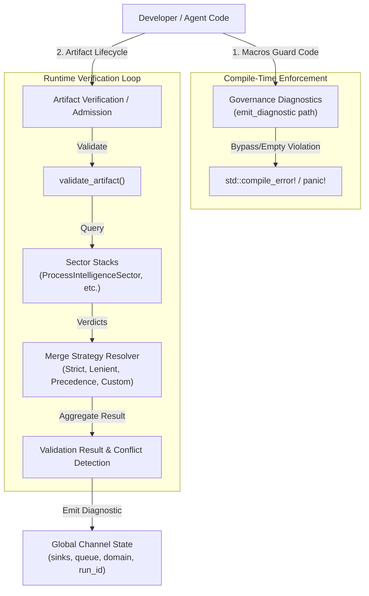

# Agent Governance Architecture

This document describes the design and flow of the agent governance sub-system in Chicago TDD Tools. It details how laws are enforced at compile-time and runtime, and how diagnostics are routed through the global channel to various sinks.

## 1. Governance Loop Architecture

The governance loop verifies that code modifications, metadata, and runtime execution conform to safety and regulatory laws. It operates in two phases:
1. **Compile-Time Static Verification**: Scans token streams for forbidden constructs via governance macros.
2. **Runtime Execution Verification**: Monitors artifact admission, sector validation stacks, and merge strategies during runtime execution.



## 2. Diagnostic Data Flow

Diagnostics are generated from macro assertion failures or schema validation conflicts. They are emitted to the global diagnostics channel which applies thread-safe synchronization and routes the reports to registered sinks (W27 probe: the capacity knob is write-only — no enforcement exists).

```mermaid
graph LR
    %% Data Sources
    subgraph Violations ["Violation Triggers"]
        MacroFail["Macro Assertion Failure<br>(Drift, Substrate, Bypass, etc.)"]
        RuntimeValidation["validate_artifact Failure / Conflict"]
    end

    %% Channel
    subgraph ChannelSync ["Global Diagnostics Channel"]
        EmitDiag["emit_diagnostic(Diagnostic)"]
        Queue["Global Queue<br>(Capacity Limited)"]
        CloseChan["close_channel()"]
        RunSummary["Compile RunSummary<br>(andon_count, p_admitted, etc.)"]
    end

    %% Sinks
    subgraph Sinks ["Diagnostic Sinks"]
        CustomSinks["Registered DiagnosticSinks<br>(Loggers, Metrics, etc.)"]
    end

    %% Flow
    MacroFail -->|Emit Diagnostic| EmitDiag
    RuntimeValidation -->|Emit Diagnostic| EmitDiag

    EmitDiag -->|unconditional queue push (W27 probe)| Queue
    EmitDiag -->|queue push (no capacity check — W27 probe)| CustomSinks

    Queue -->|On Close| CloseChan
    CloseChan -->|Summarize| RunSummary
    CloseChan -->|Drain to Sinks| CustomSinks
```
